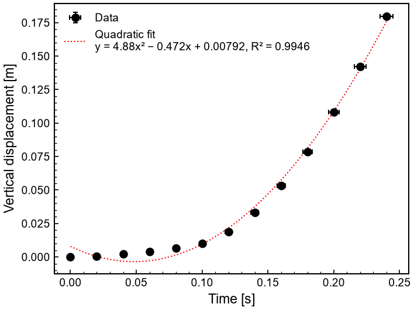

# calculating_g.xlsx · figure v3



| | |
|---|---|
| Made with | Plotwise, session `e2901bbed4`, figure v3, 2026-10-18 08:53 |
| Request | add the equation for the trendline |
| Made by | Claude |
| Data | `calculating_g.xlsx`, SHA-256 `541e6a1546eef94ed970488078a7cb72a65ad7e1344cd94459901d698657169a` (not included here) |
| Integrity check | **WARN**: 13/13 plotted points traced to a source row, 0 not in the data, 0 rows missing |
| Changes to the data | Polynomial (degree 2) fit added over the data (13 points of 'Y-displacement(meters)' vs 'Time (seconds)' from sheet 'Sheet1', x from 0 to 0.24): y = (4.88 ± 0.27)·x² + (-0.472 ± 0.068)·x + (0.0079 ± 0.0035), R² = 0.9946 |
| Style | guide: Documentation_instructions_CERN_LHCb.pdf + 1 past plot (7_CHI2DOF_significance.C) |

## Files

- `figure.pdf / .png / .svg`: the figure (the PDF and PNG carry the session, version and data SHA-256 in their metadata)
- `plot_code.py`: the plotting code that made it
- `reproduce.py`: rebuilds the figure from the data file without Plotwise
- `integrity.json`: the point-by-point check
- `inspector.html`: open in a browser to click any point and see its source row
- `ai_log.md`: every step the AI, the app and the scientist took
- `style.json`: the style that was applied
- `manifest.json`: SHA-256 of every file here, to show nothing was changed afterwards

## Rebuild the figure

```
python reproduce.py path/to/calculating_g.xlsx
```

reproduce.py warns if the data file's SHA-256 differs from the one above.
