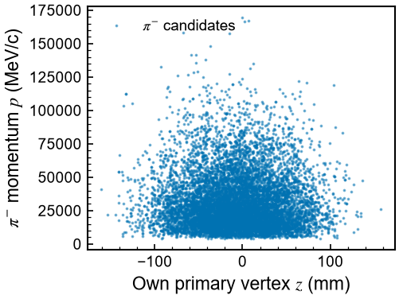

# piminus_data.csv · figure v3



| | |
|---|---|
| Made with | Plotwise, session `d394651f13`, figure v3, 2026-10-17 17:50 |
| Request | make the points smaller |
| Made by | Claude |
| Data | `piminus_data.csv`, SHA-256 `adcb6630f26b0bd9eb883c761876aa6988712b87adf7cd7681c40b64772577af` (not included here) |
| Integrity check | **PASS**: 10000/10000 plotted points traced to a source row, 0 not in the data, 0 rows missing |
| Changes to the data | None, every point is plotted as it is in the file |
| Style | guide: Documentation_instructions_Physical_Reviews_B.docx + 1 past plot (7_CHI2DOF_significance.C) + 1 typed preference |

## Files

- `figure.pdf / .png / .svg`: the figure (the PDF and PNG carry the session, version and data SHA-256 in their metadata)
- `plot_code.py`: the plotting code that made it
- `reproduce.py`: rebuilds the figure from the data file without Plotwise
- `integrity.json`: the point-by-point check
- `inspector.html`: open in a browser to click any point and see its source row
- `ai_log.md`: every step the AI, the app and the scientist took
- `style.json`: the style that was applied
- `manifest.json`: SHA-256 of every file here, to show nothing was changed afterwards

## Rebuild the figure

```
python reproduce.py path/to/piminus_data.csv
```

reproduce.py warns if the data file's SHA-256 differs from the one above.
